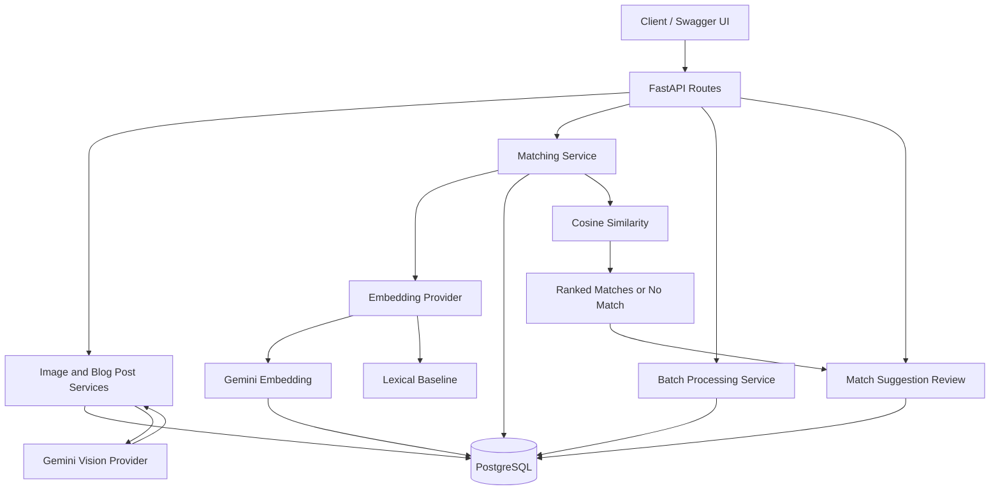

# Image Relevance & Auto-Tagging Engine

A FastAPI backend for automated image metadata extraction, confidence-based review, batch processing, and matching images with relevant blog posts using AI-powered text embeddings.

The project integrates **Google Gemini Vision** for image metadata analysis and **Google Gemini Embedding** for semantic text matching. It uses PostgreSQL to persist image records, blog posts, embeddings, batch jobs, and match suggestions.

## Features

- REST API built with FastAPI.
- PostgreSQL persistence using SQLAlchemy.
- Database schema migrations with Alembic.
- Image upload with file validation and configurable upload-size limits.
- AI-powered image metadata extraction using Gemini Vision.
- Structured metadata containing subjects, categories, attributes, captions, and confidence scores.
- Low-confidence metadata review flagging.
- Blog-post creation and retrieval.
- Gemini text embeddings for image metadata and blog-post content.
- Persistent 768-dimensional embeddings stored in PostgreSQL.
- Semantic similarity matching using cosine similarity.
- Lexical matching baseline as an alternative provider.
- Explicit mismatch guard for supported animal subjects and selected categories.
- Configurable similarity threshold and no-match behavior.
- Batch-job API with retry and failure-handling logic.
- Persisted match suggestions with approval and rejection workflows.
- Review-status filtering for match suggestions.
- Embedding backfill script for existing records.
- Automated tests using pytest.
- A reproducible, 10-case synthetic evaluation script (text-only lexical baseline; does not evaluate real images, Gemini embeddings, API endpoints, database persistence, or the full pipeline).

## Architecture



## Technology Stack

- Python
- FastAPI
- Pydantic
- SQLAlchemy
- PostgreSQL
- Alembic
- Pillow
- Google Gen AI SDK
- Gemini Vision
- Gemini Embedding
- pytest

## Prerequisites

- Python compatible with the versions declared in `requirements.txt`
- PostgreSQL
- Git
- Windows PowerShell or an equivalent terminal
- Google Gemini API key for AI-powered metadata analysis and embeddings

## Local Setup

### 1. Clone the repository

```powershell
git clone https://github.com/Plabon-Basak/flyrank-capstone-image-relevance.git
cd flyrank-capstone-image-relevance
```

### 2. Create and activate a virtual environment

```powershell
python -m venv .venv
.\.venv\Scripts\Activate.ps1
```

### 3. Install dependencies

```powershell
python -m pip install --upgrade pip
pip install -r requirements.txt
```

### 4. Configure environment variables

Create a local `.env` file based on `.env.example`.

Configure the PostgreSQL connection for a database you have created. Do not commit `.env` or put passwords and API keys in source control.

For Gemini-powered analysis and semantic matching, configure the relevant settings:

```dotenv
METADATA_PROVIDER=gemini
GEMINI_VISION_MODEL=gemini-3.8-flash

EMBEDDING_PROVIDER=gemini
GEMINI_EMBEDDING_MODEL=gemini-embedding-001
EMBEDDING_DIMENSIONS=768
```

Other relevant settings include:

| Variable | Purpose |
|---|---|
| `DATABASE_URL` | SQLAlchemy PostgreSQL connection string |
| `UPLOAD_DIR` | Directory for uploaded image files |
| `MAX_UPLOAD_SIZE_MB` | Maximum permitted upload size |
| `METADATA_PROVIDER` | Metadata provider selection |
| `GEMINI_API_KEY` | Gemini API authentication |
| `GEMINI_VISION_MODEL` | Gemini vision model selection |
| `EMBEDDING_PROVIDER` | Matching provider selection |
| `GEMINI_EMBEDDING_MODEL` | Gemini embedding model selection |
| `EMBEDDING_DIMENSIONS` | Embedding vector dimensions |
| `MATCHING_THRESHOLD` | Minimum similarity for accepting a match |

The lexical provider can be selected as an alternative:

```dotenv
EMBEDDING_PROVIDER=lexical
```

Keep API keys and database credentials private. Gemini API usage may be subject to quotas and charges depending on the account and model.

### 5. Apply database migrations

Ensure PostgreSQL is running and the configured database is available.

```powershell
alembic upgrade head
```

### 6. Start the API

```powershell
python -m uvicorn app.main:app --reload
```

The API is available at:

- **Base URL:** `http://127.0.0.1:8000`
- **Interactive documentation:** `http://127.0.0.1:8000/docs`
- **Health check:** `http://127.0.0.1:8000/health`

Use Swagger UI to inspect request schemas and execute API requests.

## API Endpoints

| Method | Endpoint | Purpose |
|---|---|---|
| GET | `/health` | Health check |
| POST | `/images` | Create an image record |
| POST | `/images/upload` | Upload an image |
| GET | `/images` | List image records |
| GET | `/images/{image_id}` | Retrieve an image record |
| POST | `/images/{image_id}/analyze` | Request image metadata analysis |
| GET | `/images/{image_id}/matches` | Rank blog posts and persist match suggestions |
| POST | `/blog-posts` | Create a blog post |
| GET | `/blog-posts` | List blog posts |
| GET | `/blog-posts/{post_id}` | Retrieve a blog post |
| POST | `/batch-jobs` | Create a batch job |
| GET | `/batch-jobs/{job_id}` | Retrieve batch-job status |
| GET | `/match-suggestions` | List match suggestions with optional review-status filtering |
| POST | `/match-suggestions/{suggestion_id}/review` | Approve or reject a pending suggestion |

## Image Analysis

The image analysis workflow uses Gemini Vision to extract structured metadata from uploaded images.

The generated metadata can include:

- Subject
- Category
- Attributes
- Dominant colors
- Objects
- Visual details
- Image caption
- Confidence score

The confidence score is used by the application to determine whether an image requires additional review.

The metadata provider can be configured through environment variables.

## Semantic Matching

The matching pipeline uses text representations of image metadata and blog-post content.

### Embedding generation

The Gemini embedding provider uses:

- Model: `gemini-embedding-001`
- Embedding dimensions: 768
- Task type: `SEMANTIC_SIMILARITY`

For image records, the embedding input is generated from available metadata and captions. For blog posts, it is generated from the post content.

**These are text embeddings derived from image metadata, not direct visual embeddings generated from image pixels.**

### Persistent embeddings

Embeddings are stored in PostgreSQL alongside their associated image and blog-post records.

The application can reuse persisted embeddings during matching rather than regenerating every vector for every request.

For existing records, the backfill script can generate and save missing embeddings:

```powershell
python -m scripts.backfill_embeddings
```

### Matching workflow

The matching service:

1. Builds text from available image metadata.
2. Retrieves or generates the relevant embeddings.
3. Excludes candidates that trigger the explicit mismatch guard.
4. Computes cosine similarity between eligible image and blog-post vectors.
5. Ranks eligible blog posts by similarity.
6. Returns accepted matches only when they meet the configured threshold.
7. Returns `no_match` when no eligible candidate reaches the threshold.
8. Returns `review_required` when image confidence is missing or below the configured minimum.
9. Persists match suggestions for subsequent review.

The lexical baseline remains available as an alternative matching provider. It uses token-based similarity and simple normalization, but cannot reliably recognize synonyms or understand image contents.

A similarity score alone does not establish that a match is genuinely relevant. Matching quality must be evaluated against a representative, independently labeled dataset.

## Match-Suggestion Review

The matching endpoint can create persisted suggestions linking images to blog posts.

New suggestions initially use the `pending` status.

The review endpoint supports:

- `approved`
- `rejected`

A review request can include an optional `decision_reason`.

Example request:

```json
{
  "status": "approved",
  "decision_reason": "Relevant to the article content."
}
```

A suggestion that has already been reviewed cannot be reviewed again through the review endpoint. The API returns `409 Conflict` for an attempt to review it again.

To filter suggestions by review status:

```text
GET /match-suggestions?review_status=pending
GET /match-suggestions?review_status=approved
GET /match-suggestions?review_status=rejected
```

Valid filter values are `pending`, `approved`, and `rejected`.

## Batch Processing

The batch-job API provides a workflow for processing multiple image records.

Implemented functionality includes:

- Batch-job creation.
- Job status retrieval.
- Processing progress and failure tracking.
- Retry and failure-handling logic.
- Integration with the configured metadata and embedding providers.

A full-scale production batch evaluation with a representative image dataset remains outstanding.

## Automated Tests

Run the complete test suite:

```powershell
python -m pytest -q
```

Latest verified test result:

**105 passed, 1 warning.**

The warning relates to a dependency deprecation and did not prevent the tests from passing.

Also check Python compilation:

```powershell
python -m compileall -q app scripts
```

## Evaluation

Run the synthetic evaluation script:

```powershell
python scripts/evaluate.py
```

### Measured baseline results

Evaluation date: 23 October 2026.

| Metric | Measured result |
|---|---:|
| Labeled synthetic cases | 10 |
| Top-1 precision | 7/10 = 70.0% |
| Accepted matches | 5/10 = 50.0% |
| Precision among accepted matches | 5/5 = 100.0% |

These results come from a small, manually labeled synthetic text-only dataset using the lexical baseline. They do not evaluate real image files, Gemini embeddings, API endpoints, or database persistence. They are not evidence of production performance. In particular, the accepted-match precision estimate is based on only five accepted cases.

The synthetic evaluation provides a reproducible baseline, not a substitute for evaluation on a representative, independently labeled dataset of at least 40 images across at least four categories.

## Current Limitations

- **Matching quality:** Semantic matching has been exercised, but representative dataset evaluation is still needed to establish relevance accuracy.
- **Visual embeddings:** The current embedding pipeline uses text derived from image metadata and captions, not direct image-pixel embeddings.
- **Dataset size:** The required larger labeled image and blog-post dataset has not yet been established.
- **Batch evaluation:** The full multi-image batch workflow with genuine vision inference needs further validation.
- **Cost tracking:** API usage and cost tracking are partially implemented (vision/embedding reservations, cost calculation, budget checks, and persistence). Batch processing and backfill do not yet fully participate in tracked cost accounting.
- **Human review:** The API supports confidence flags and match-suggestion decisions; a dedicated human-review interface is not included.
- **Production readiness:** Authentication, authorization, rate limiting, deployment configuration, and operational monitoring require further work.

## Security and Data Handling

- Keep `.env` out of Git.
- Do not commit API keys, database credentials, or uploaded private images.
- Use appropriate upload validation and size limits.
- Configure production secrets through a secret manager or protected environment variables.
- Review authentication, authorization, rate limits, file-serving permissions, and resource limits before production deployment.
- Use appropriate access controls and retention policies when handling private or sensitive images.

## Project Status

The project implements a FastAPI backend with PostgreSQL persistence, image upload and storage, Gemini Vision metadata analysis, Gemini text embeddings, persisted embedding records, semantic matching, batch-job workflows, and a match-suggestion review API.

The Gemini integration and embedding persistence have been manually verified, and the automated test suite has passed 87 tests.

The next major validation priorities are building the required labeled dataset (at least 40 images across at least four categories and at least 10 labeled blog posts), evaluating matching quality on that dataset using the actual pipeline, validating multi-image batch processing with genuine vision inference, and completing cost tracking coverage across batch and backfill workflows.

## License

See [LICENSE](LICENSE).


**Dataset licensing/provenance:** Development/test corpus of placeholder images from Lorem Picsum endpoints. Individual original image URLs and photographer identities were not recorded, and individual image licenses have not been verified. Images must NOT be described as public domain, openly licensed, or copyright-free. See data/eval/manifest.json for recorded source/attribution/provenance.
