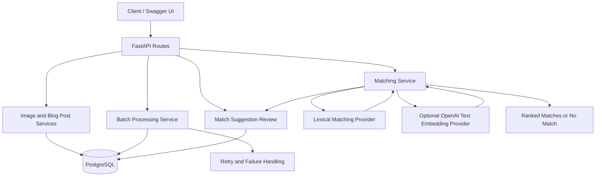

# Image Relevance & Auto-Tagging Engine

A FastAPI backend prototype for image metadata management, confidence review, batch-processing workflows, and matching images to relevant blog posts.

**Current matching implementation:** A local lexical baseline using TF-IDF-style token statistics. It does not perform neural image understanding or true semantic image embedding.

## Features

- REST API built with FastAPI.
- PostgreSQL persistence using SQLAlchemy.
- Database schema migrations with Alembic.
- Image upload with file validation and configurable upload-size limits.
- Structured image metadata schema with confidence scores.
- Low-confidence review flagging.
- Blog-post creation and retrieval.
- Image-to-blog-post ranking using a configurable similarity threshold.
- Explicit mismatch guard for supported animal subjects and selected categories.
- Batch-job API with retry and failure-handling logic.
- Local lexical matching baseline and optional OpenAI text-embedding provider.
- Persisted match suggestions with approval and rejection workflows.
- Review-status filtering for match suggestions.
- Automated tests using pytest.
- A reproducible, 10-case synthetic evaluation script.

## Architecture



## Technology Stack

- Python
- FastAPI
- Pydantic
- SQLAlchemy
- PostgreSQL
- Alembic
- Pillow
- pytest
- OpenAI Python SDK (optional embedding provider)

## Prerequisites

- Python compatible with the versions declared in `requirements.txt`
- PostgreSQL
- Git
- Windows PowerShell or an equivalent terminal

## Local Setup

### 1. Clone the repository

```powershell
git clone https://github.com/Plabon-Basak/flyrank-capstone-image-relevance.git
cd flyrank-capstone-image-relevance
```

### 2. Create and activate a virtual environment

```powershell
python -m venv .venv
.\.venv\Scripts\Activate.ps1
```

### 3. Install dependencies

```powershell
python -m pip install --upgrade pip
pip install -r requirements.txt
```

### 4. Configure environment variables

Create a local `.env` file based on `.env.example`.

Configure the PostgreSQL connection for a database you have created. Do not commit `.env` or put passwords and API keys in source control.

Relevant settings include:

| Variable | Purpose |
|---|---|
| `DATABASE_URL` | SQLAlchemy PostgreSQL connection string |
| `UPLOAD_DIR` | Directory for uploaded image files |
| `MAX_UPLOAD_SIZE_MB` | Maximum permitted upload size |
| `METADATA_PROVIDER` | Metadata provider configuration |
| `EMBEDDING_PROVIDER` | Matching provider selection |
| `MATCHING_THRESHOLD` | Minimum similarity for accepting a match |
| `EMBEDDING_API_KEY` | Optional API key for OpenAI embeddings |
| `EMBEDDING_MODEL` | OpenAI embedding model name |

For local matching, use:

```dotenv
EMBEDDING_PROVIDER=lexical
```

The current default metadata provider is a mock provider. A mock response is not real image analysis.

### 5. Apply database migrations

Ensure PostgreSQL is running and the configured database is available.

```powershell
alembic upgrade head
```

### 6. Start the API

```powershell
python -m uvicorn app.main:app --reload
```

The API is available at:

- **Base URL:** `http://127.0.0.1:8000`
- **Interactive documentation:** `http://127.0.0.1:8000/docs`
- **Health check:** `http://127.0.0.1:8000/health`

Use Swagger UI to inspect request schemas and execute API requests.

## API Endpoints

| Method | Endpoint | Purpose |
|---|---|---|
| GET | `/health` | Health check |
| POST | `/images` | Create an image record |
| POST | `/images/upload` | Upload an image |
| GET | `/images` | List image records |
| GET | `/images/{image_id}` | Retrieve an image record |
| POST | `/images/{image_id}/analyze` | Request image metadata analysis |
| GET | `/images/{image_id}/matches` | Rank blog posts for an image and persist match suggestions |
| POST | `/blog-posts` | Create a blog post |
| GET | `/blog-posts` | List blog posts |
| GET | `/blog-posts/{post_id}` | Retrieve a blog post |
| POST | `/batch-jobs` | Create a batch job |
| GET | `/batch-jobs/{job_id}` | Retrieve batch-job status |
| GET | `/match-suggestions` | List match suggestions, optionally filtered by review status |
| POST | `/match-suggestions/{suggestion_id}/review` | Approve or reject a pending match suggestion |

### Match-suggestion review

The matching endpoint can create persisted suggestions linking images to relevant blog posts. Suggestions initially use the `pending` status.

The review endpoint supports these decisions:

- `approved`
- `rejected`

A review request can include an optional `decision_reason`.

Example request:

```json
{
  "status": "approved",
  "decision_reason": "Relevant to the article content."
}
```

A suggestion that has already been reviewed cannot be reviewed again through the review endpoint. The API returns `409 Conflict` for an attempt to review it again.

To filter suggestions by review status, use the `review_status` query parameter:

```text
GET /match-suggestions?review_status=pending
GET /match-suggestions?review_status=approved
GET /match-suggestions?review_status=rejected
```

Valid filter values are `pending`, `approved`, and `rejected`. An empty list is returned when no suggestions match the requested status.

## Matching Behavior

The matching service:

1. Builds text from available image metadata.
2. Excludes candidates that trigger the explicit mismatch guard.
3. Computes similarity using the configured matching provider.
4. Ranks eligible blog posts by similarity.
5. Returns accepted matches only when they meet the configured threshold.
6. Returns `no_match` when no eligible candidate reaches the threshold.
7. Returns `review_required` when image confidence is missing or below the configured minimum.
8. Persists match suggestions so they can be reviewed and filtered by status.

The local lexical baseline uses token statistics and simple plural normalization. It is lightweight and suitable for demonstrating the matching pipeline, but it cannot reliably recognize synonyms or infer image contents from pixels.

For example, `fox` and `foxes` can be normalized to a common token. This does not guarantee that scientific names such as `Vulpes vulpes` will match correctly.

The optional OpenAI embedding provider generates text embeddings. Text embeddings can improve text-based matching, but they do not independently provide image-pixel understanding.

## Automated Tests

Run the complete test suite:

```powershell
python -m pytest -q
```

The project has passed **84 automated tests** during development. Run the test suite on the current checkout to confirm the latest state.

## Evaluation

Run the synthetic evaluation script:

```powershell
python scripts/evaluate.py
```

### Measured baseline results

Evaluation date: 23 October 2026.

| Metric | Measured result |
|---|---:|
| Labeled synthetic cases | 10 |
| Top-1 precision | 7/10 = 70.0% |
| Accepted matches | 5/10 = 50.0% |
| Precision among accepted matches | 5/5 = 100.0% |

These figures come from a small, manually labeled synthetic dataset. They are not evidence of production performance, and the accepted-match precision estimate is based on only five accepted cases.

The evaluation script provides a reproducible baseline, not a substitute for evaluation on a representative, independently labeled dataset.

## Current Limitations

- **Image understanding:** The configured mock metadata provider does not perform real vision-model inference.
- **Embeddings:** The lexical baseline is not a neural semantic embedding model. The optional OpenAI provider generates text embeddings, not image embeddings.
- **Persisted vectors:** The current matching flow computes vectors during matching; it does not yet provide a complete persisted image/post embedding lifecycle.
- **Batch processing:** Mock metadata is deliberately rejected as real analysis, so successful production-quality image analysis requires a genuine metadata provider.
- **Evaluation:** The current benchmark is small and synthetic.
- **Confidence review:** Low-confidence image metadata can be flagged for review. Additional integration may be needed for a complete human-review interface.
- **Cost tracking:** Per-call vision and embedding cost persistence and budget enforcement are not yet implemented.
- **Production readiness:** Authentication, authorization, rate limiting, deployment configuration, and operational monitoring require further work.

## Security and Data Handling

- Keep `.env` out of Git.
- Do not commit API keys, database credentials, or uploaded private images.
- Use appropriate upload validation and size limits.
- Configure production secrets through a secret manager or protected environment variables.
- Review authentication, authorization, rate limits, file-serving permissions, and resource limits before production deployment.
- Use appropriate access controls and retention policies when handling private or sensitive images.

## Project Status

This repository is an actively developed backend capstone prototype. The API, PostgreSQL integration, image upload and storage, metadata-analysis workflow, lexical matching baseline, batch-job scaffolding, and persisted match-suggestion review workflow are implemented. The automated test suite has passed 84 tests during development, and the review-status filters and duplicate-review protection have been verified through the live API.

Real vision inference, a complete persisted embedding lifecycle, cost accounting, and production deployment hardening remain additional implementation work.

## License

See [LICENSE](LICENSE).
